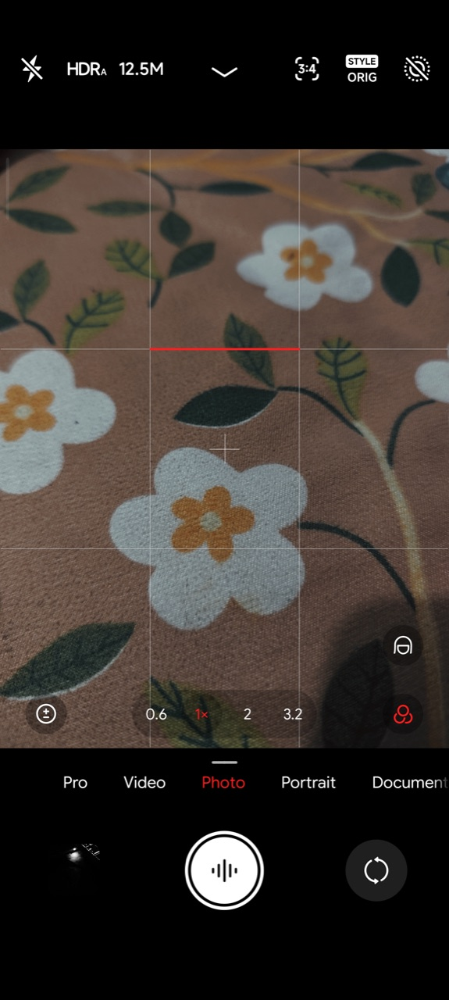
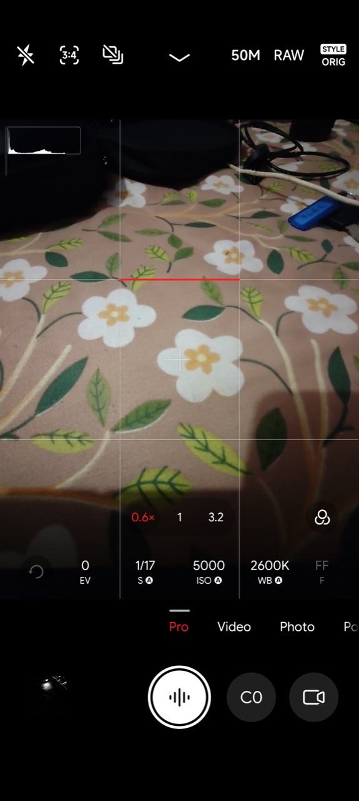
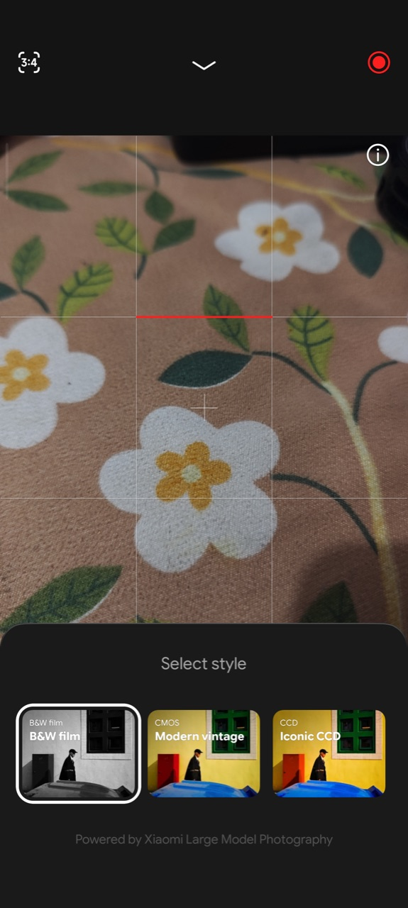
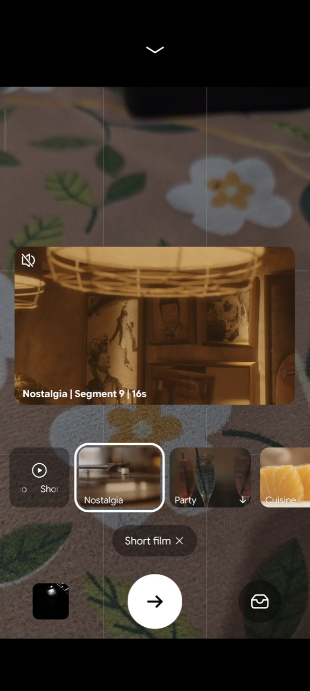

# houji-miuicamera-port

Xiaomi's newer camera app on AOSP ROMs for the Xiaomi 14 (houji), in place of the 6.4 MiuiCamera those ROMs ship.

Two CN builds are supported:

- **6.8.002090.2** from the Xiaomi 18 Pro (recommended)
- **6.7.000280.0** from the Xiaomi 17

With 6.8 you get the newer interface, Leica styles and filters, film grain, 50MP on all three rear lenses, 50MP RAW, lens and front/rear switching while recording, Dolby Vision in the viewfinder, Ultra HDR photos, Fastshot, Short film, Dual video and Open Gate.

| Photo, 50MP lenses and Style | Pro at 50MP with RAW | Essential Moment (Leica looks) | Short film |
| --- | --- | --- | --- |
|  |  |  |  |

## Choose how to install

| You are | Use | Needs |
| --- | --- | --- |
| A rooted user | The KernelSU module from [Releases](https://github.com/spundone/houji-miuicamera-port/releases), which installs an LSPosed module | KernelSU (or KernelSU Next) and an LSPosed framework (Vector or LSPosed); the camera APK in `Download` |
| A rooted user without LSPosed | A KernelSU-only zip you build yourself ([Build](#build)) | KernelSU only. The zip carries the patched camera, so it is never published |
| A ROM maintainer | [android_device_xiaomi_houji-miuicamera-port](https://github.com/spundone/android_device_xiaomi_houji-miuicamera-port), a device tree with the patched APK and Leica Essential | A houji tree that includes the 6.4 houji-miuicamera trees |

All three apply the same fixes. The KernelSU module hooks the camera at runtime with LSPosed; the other two use a copy of the camera patched ahead of time by [`aosp/`](aosp/README.md).

## Install (KernelSU module)

1. Root with KernelSU and install an LSPosed framework.
2. Copy the camera APK to the phone's `Download` folder. [Getting the camera APKs](docs/houji-camera.md#4-getting-the-camera-apks) lists where to find them and their SHA-256.
3. Optional, for Essential Moment's Leica looks: also copy the community Leica port of camera 6.8 (`com.kobbin.leica` 6.8.001960.0, SHA-256 `b2bf1186e6c0004621e19d914feb1d0e8106e2d976edc0634e01c30d6bc90082`). The installer copies what it needs from it; the port app itself isn't installed.
4. Install `houji-miuicamera-port-<version>.zip` in the KernelSU manager. It checks the phone and the APK, then installs the LSPosed module it carries. With Vector it also enables it for the camera; with other LSPosed builds, enable **MiuiCamera port for houji** yourself (its scope is preset).
5. Reboot.

The adaptive launcher icon needs a mount module (such as Hybrid Mount) with this zip; the KernelSU-only zips mount it themselves.

To uninstall, remove the module in the KernelSU manager, reboot, then uninstall the LSPosed module. The ROM's camera comes back.

## Tested on

- Xiaomi 14 (houji), Infinity X 4.0, Android 17, kernel 6.1
- KernelSU Next 3.4.2 with Hybrid Mount, Vector 2.2
- MIUI Gallery 4.3.1.15-global from the Miui Gallery Global module ([docs/miui-gallery.md](docs/miui-gallery.md)), optional
- MiuiCamera 6.8.002090.2, SHA-256 `729b0b193d1684e7c14ed0ca56ba15247d58016c70164329de233b49727a2c48`
- MiuiCamera 6.7.000280.0, SHA-256 `1cec1ff2203d9d1c358b7ea24f6db5b62adeb5d3f6ceca48b0fa1df932d685d9`

Other houji ROMs with Xiaomi's camera stack (`/system/priv-app/MiuiCamera` and the stock camera HAL) should work. The installer refuses other phones and other camera builds.

## Features

Everything below works on 6.8. Items marked (6.7 too) also work on 6.7.

**Photo**
- Main, 0.6x, 2x and 3.2x, saved through Xiaomi's background processing (6.7 too)
- Leica Vibrant and Authentic, filters, watermarks (6.7 too), plus Style ORIG (no Leica look) and film grain with the 18 Pro's presets
- 50MP on the ultra-wide, main and telephoto, in Photo (4:3 or 1:1) and Pro. At 50MP the lens changes at each stop (0.6x, 1x, 3.2x)
- 50MP RAW (DNG) in Pro on all three lenses, and 12.5MP RAW on the telephoto
- Ultra HDR JPEG with a gain map; Ultra HDR HEIF as an opt-in (the module's Action button), since Google Photos can't back those up and macOS can't open them
- Telemacro (Super Macro uses the telephoto), Portrait's 1x and 2.6x buttons, 1/8000 s in Pro
- Watermarks print "Xiaomi 14" and work with HEIF photos
- Essential Moment: the M9 Iconic CCD, M3 B&W film and M10R Modern vintage looks, with the Leica port installed. JPEG only, 3 to 5 s per photo

**Video**
- Up to 4K60, and Dolby Vision (profile 8.4, HLG) up to 4K60 (6.7 too)
- Switching lenses while recording, including 4K60 and 4K30 Dolby Vision (6.7 too)
- Switching between rear and front camera while recording at 720p, 1080p and 4K30, with a 0.2 s hitch (6.7 too)
- Dolby Vision toggle in the viewfinder, and Dolby Vision on the front camera at 1080p30 and 4K30
- Live moments (motion photos) from the snapshot button while recording, tracking focus in Pro (6.7 too)
- Open Gate in Pro video (4096x3072 at 30 or 60 fps), Import LUT for Log
- Video filters up to 4K, limited to those the phone has tables for; the front camera gets the Xiaomi 14's own set
- Front screen fill light at a steady 60 fps

**Modes**
- Fastshot (Street) with 28, 35, 50 and 75 mm presets
- Short film: template clips recorded segment by segment, as on the stock Xiaomi 14
- Dual video (front and rear together), Movie (1080p 24 fps)
- Short video: records and saves, but zoom and multi-clip recording don't work

**Also**
- Haptics for the shutter, zoom, dials and sliders

## Known limitations

- **Camera 6.8 has no Xiaomi 14 profile.** It runs on Xiaomi's generic flagship profile with the Xiaomi 14's own values from 6.7. The 18 Pro's Ultra-pixel mode stays off, and there's no 25MP option (this sensor offers 12.5MP and 50MP).
- **No Original portrait.** houji's HAL renders it from the main camera at 2.6x, so Portrait offers Master and Leica portrait only, as on the stock Xiaomi 14.
- **The telephoto falls back to the main camera up close** in Photo and Portrait at 12.5MP. Settings > Adaptive telephoto (off by default) reaches the HAL; 50MP always uses the telephoto.
- **Not possible on this HAL:** Open Gate in Video mode, Movie at 4K, video HDR at 4K60 or on the front camera. Each crashed the camera service when forced.
- **Front camera while recording** isn't offered at 4K60 or with Dolby Vision at 4K, as on Xiaomi's phones.
- **4K60 lens switching isn't advertised by the HAL.** It worked in testing (files stay 3840x2160 at about 58 fps), but long clips may run hot.
- **Essential Moment's notices are in Chinese** in the KernelSU-only and ROM builds; the LSPosed build translates them. The port's AI style model needs the Snapdragon 8 Elite Gen 5, so its fallback tone is used.
- **HDR and Dolby Vision are separate.** Dolby Vision records 10-bit HLG; the HDR tile merges exposures but records 8-bit SDR unless Dolby Vision is on too.
- **The CN build's China-only extras stay on.** Only the consent check is redirected. The camera shows Xiaomi's terms on first launch.
- **Switching camera builds** can close the camera with "invalid module index". Clear its data once (`pm clear com.android.camera`).

## Build

Needs JDK 11+ and an Android SDK with `platforms;android-34` and build-tools.

```bash
scripts/build.sh            # LSPosed APK and KernelSU module zip in dist/, debug-signed
scripts/build.sh --release  # signed with XCAM17_KEYSTORE, XCAM17_KEYSTORE_PASS, XCAM17_KEY_ALIAS
```

`--apk FILE` also writes a `-with-apk.zip` that carries the camera APK. It contains Xiaomi's binary, so keep it to yourself.

KernelSU-only zips, after `build.sh`:

```bash
aosp/tools/patch-apk.sh MiuiCamera.apk patched.apk   # see aosp/README.md for what it needs
scripts/build-kit-zip.sh patched.apk [--leica LEICA_PORT.apk] [--gallery MIUIGallery.zip]
```

They need no LSPosed and no mount module: the module mounts the camera's folder and a copy of `/product/overlay` with the icon itself. With `--leica` the Leica port's files go in the zip (`-standalone`), so nothing has to be in `Download`. With `--gallery`, a second zip also installs the MIUI Gallery Global module, which does need a mount module. These zips carry Xiaomi's APK; keep them to yourself.

The ROM device tree: `aosp/tools/make-device-tree.sh patched.apk OUT_DIR [--leica LEICA_PORT.apk]`.

Pushing a `v*` tag that matches `VERSION` makes GitHub Actions build and publish a release.

## Documentation

- [docs/how-it-works.md](docs/how-it-works.md): each problem found while porting, and the evidence for each fix
- [docs/houji-camera.md](docs/houji-camera.md): the Xiaomi 14's cameras and HAL, what each file here does, where to get the APKs, how to investigate
- [aosp/README.md](aosp/README.md) and [docs/aosp-integration.md](docs/aosp-integration.md): the patcher and building the camera into a ROM
- [docs/roadmap.md](docs/roadmap.md): what's missing and what to try next
- [docs/miui-gallery.md](docs/miui-gallery.md): the MIUI Gallery module used alongside

## Legal

Not affiliated with Xiaomi or Leica, who own the camera app and their trademarks. Releases here contain only this project's code. The device tree repo carries Xiaomi's camera APK, patched, and the Leica port's code, libraries and models, which belong to their authors, Xiaomi and Leica. The KernelSU module copies the port's files from your own copy.

### Release signing

Releases are signed with a dedicated key (certificate SHA-256 `9bdc6988c94df28a23c372d6670414588601061a3464ca7fb66d0637e9fa017a`); every version must use it, or it won't install over the last. The key lives outside the repo at `~/.config/xcam17/release.jks`, with its password in the macOS Keychain as `xcam17-release-keystore`. CI reads it from the secrets `XCAM17_KEYSTORE_B64`, `XCAM17_KEYSTORE_PASS` and `XCAM17_KEY_ALIAS`.

To release: bump `VERSION`, add a `CHANGELOG.md` entry, push a matching `v*` tag. Actions → release → Run workflow builds and signs without publishing.
